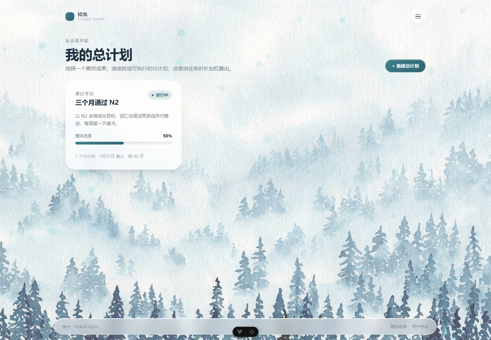
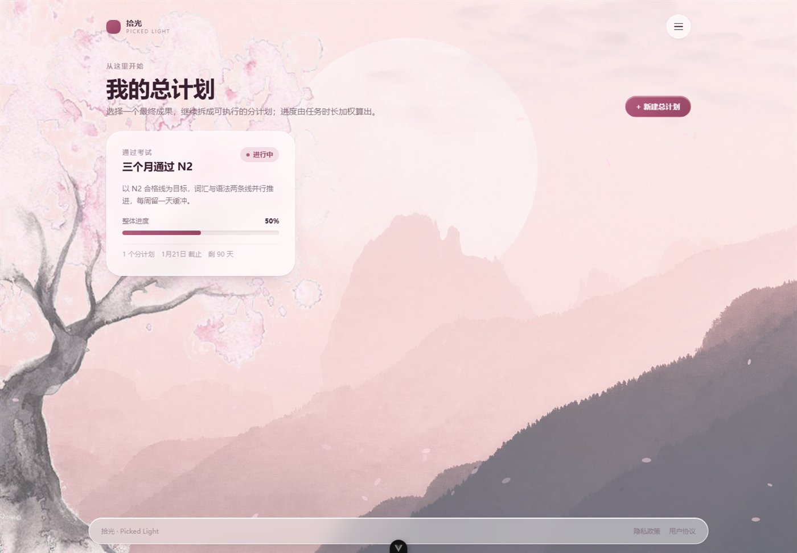
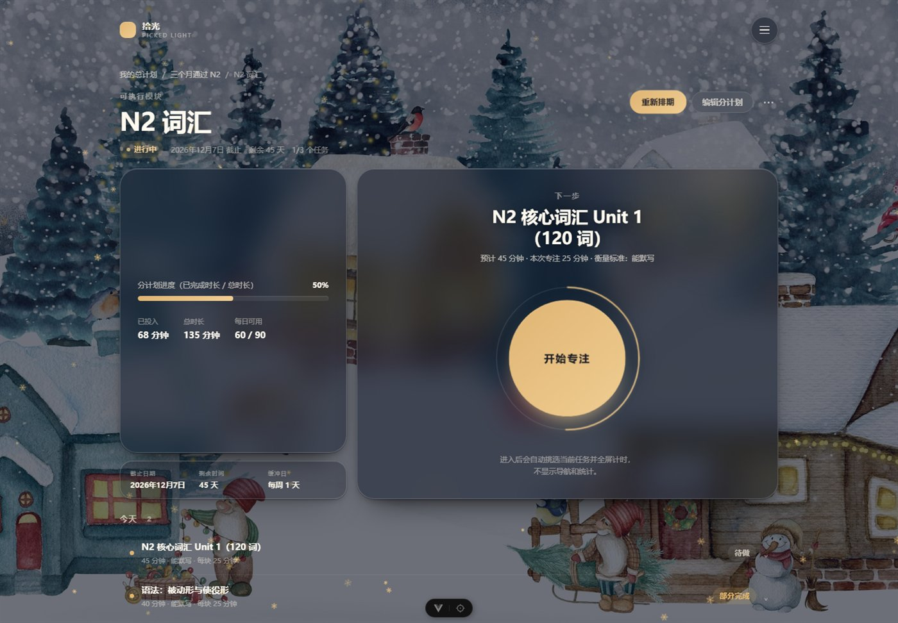
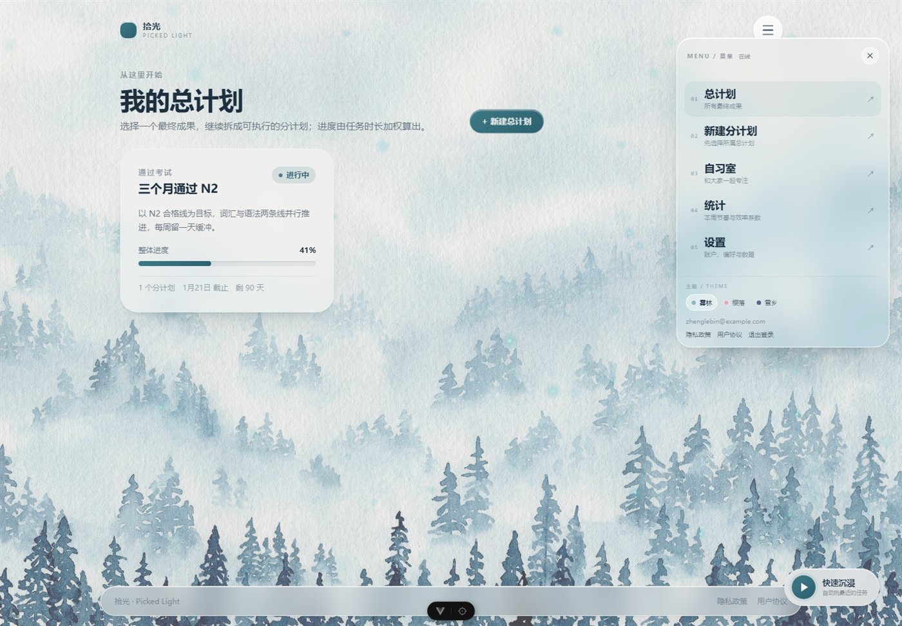
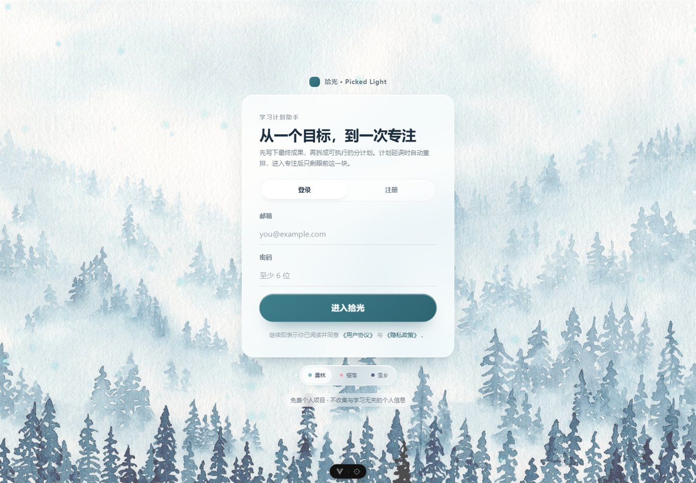
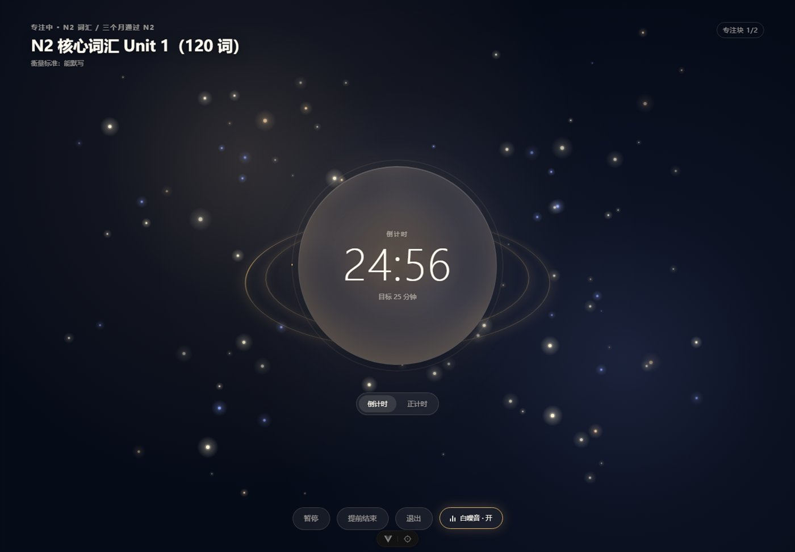
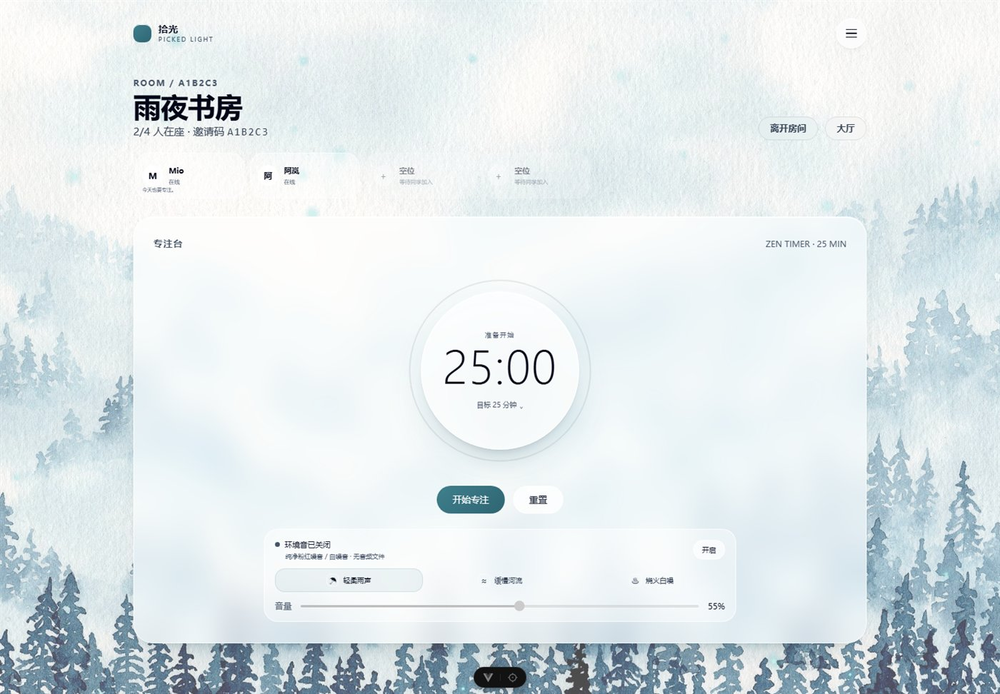
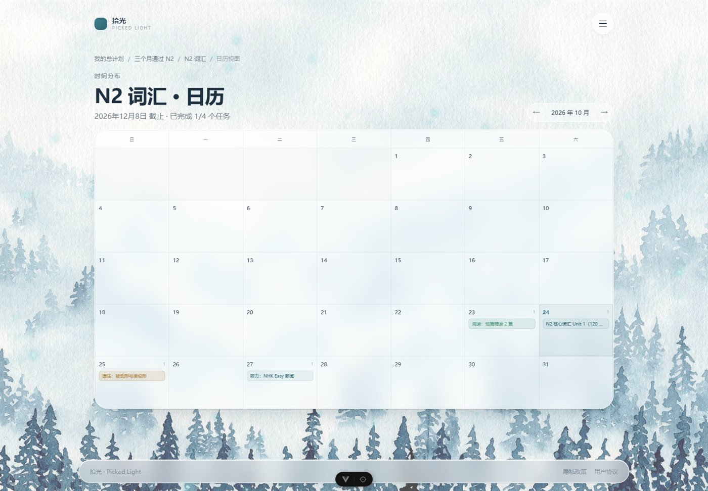

# 拾光 · Picked Light

> 一个会自己调整的学习计划助手。先设定最终成果（总计划），再拆成可执行的模块（分计划）；
> 计划延误时自动重排，从总计划进入分计划，再一次专注。

第一版（MVP）完整实现，可直接运行、可部署到 Vercel。

## 实际渲染

| 雾林 · 冷冽空灵 | 樱落 · 浪漫治愈 |
| --- | --- |
|  |  |

| 雪乡 · 非对称分计划页 | 右上角悬停菜单 |
| --- | --- |
|  |  |

| 登录页（细线输入） | 3D 治愈系专注页 |
| --- | --- |
|  |  |

| 自习室 | 分计划日历 |
| --- | --- |
|  |  |

> 三张水彩插画来自 `public/bg-forest.jpg`、`public/bg-sakura.jpg`、`public/bg-snow.jpg`；主题切换后背景交叉淡入，玻璃、文字、图表与粒子同步换色。

## 三主题系统

```text
html[data-theme="forest"]   雾林：深蓝灰文字 + 白色玻璃 + 青蓝光尘
html[data-theme="sakura"]   樱落：深紫红文字 + 白色玻璃 + 粉色花瓣
html[data-theme="snow"]     雪乡：暖白文字 + 深色玻璃 + 暖黄星点/雪花
```

- `src/stores/theme.ts`：默认 `forest`，持久化到 `shiguang.theme`，只负责写 `data-theme` 与 `color-scheme`；
- `src/assets/styles/tokens.css`：三套主题的所有颜色、玻璃、阴影、图表、专注页变量；旧 token 名全部做别名兼容；
- `src/components/layout/ArtBackground.vue`：背景图交叉淡入 + `::after` 主题遮罩 + Canvas 粒子；
- 右上角悬停菜单、设置页“外观”、登录页底部都提供三色点切换。


## 页面流转

```text
/login
  ↓ 登录成功
/                     总计划列表（落地页）
  ↓ 点击总计划卡片
/master-plans/:id     总计划详情 → 分计划列表（新增 / 编辑）
  ↓ 点击分计划卡片
/sub-plans/:id        分计划详情 → 任务列表 + 四个操作入口
  ├─ /sub-plans/:id/calendar  日历视图（按 scheduled_date 分组）
  └─ /sub-plans/:id/reschedule 重新排期
/focus?source=dashboard  首页快速沉浸（全部 pending 任务，取截止最近）
/study-room            自习室：虚拟座位 + ZenTimer + 粉红噪音
  ↓ 任务选择弹窗写入 useFocusStore.selectedTaskId
/focus                沉浸计时（全屏、无导航）
  ↓ 完成 / 部分完成 / 放弃
/sub-plans/:id        回到分计划，继续下一个任务
```

---

## 1. 技术栈

| 层 | 选择 |
| --- | --- |
| 框架 | Vue 3（Composition API + `<script setup>`）+ TypeScript |
| 构建 | Vite |
| 样式 | 原生 CSS + `<style scoped>` + CSS 变量（无 Tailwind、无 UI 组件库） |
| 路由 | Vue Router 4（`^4.6.4`，`createWebHistory`） |
| 状态 | Pinia |
| 数据 / 认证 | Supabase（PostgreSQL + Auth + RLS） |
| 测试 | Vitest |
| 部署 | Vercel |

> 已按本次要求把 `vue-router` 从模板自带的 v5 降到 `^4.6.4`；`createRouter` / `createWebHistory` / 路由守卫 API 与业务代码完全兼容。

---

## 2. 目录结构

```text
ShiguangPickedLight/
├── index.html                          # 入口 HTML：中文 lang、主题色、SEO 描述
├── vercel.json                         # Vercel 构建与 SPA fallback 配置
├── vite.config.ts                      # Vite + Vue 插件 + @ 别名
├── vitest.config.ts                    # Vitest（jsdom 环境）
├── tsconfig*.json                      # TS 项目引用（app / node / vitest）
├── env.d.ts                            # 环境变量与 Vite 客户端类型
├── .env.local                          # 本地 Supabase 地址与 publishable key（已 gitignore）
├── .env.example                        # 环境变量模板
├── package.json / package-lock.json    # 依赖与脚本
├── README.md                           # 项目说明、页面流转、规则与部署
├── UPGRADE.md                          # 三主题视觉重构完整代码快照（按四个步骤排列）
├── docs/screenshots/                   # 三主题 / 右上角菜单 / 非对称分计划页截图
├── public/
│   ├── bg-forest.jpg                   # 雾林水彩插画
│   ├── bg-sakura.jpg                   # 樱落水彩插画
│   ├── bg-snow.jpg                     # 雪乡水彩插画
│   ├── favicon.svg                     # 站点图标
│   └── favicon.ico                     # 兼容旧浏览器
├── supabase/
│   └── schema.sql                      # 建表 + 约束 + RLS + 进度视图（可直接粘贴执行）
├── src/
│   ├── main.ts                         # 启动：Pinia → 主题 → 恢复登录态 → 挂载路由
│   ├── App.vue                         # 根组件：绘画天空 + 页面过渡 + 全局提示
│   ├── assets/styles/
│   │   ├── tokens.css                  # 设计令牌：玻璃、极光、文本、动效、明暗两套
│   │   └── base.css                    # 重置、排版、玻璃工具类、按钮/表单、reduced-motion
│   ├── types/
│   │   └── models.ts                   # 领域模型、数据库行类型、枚举与 mapper
│   ├── lib/
│   │   ├── supabase.ts                 # Supabase 单例客户端（读取 VITE_ 环境变量）
│   │   ├── date.ts                     # 本地日期工具（yyyy-MM-dd、时区安全）
│   │   ├── errors.ts                   # Supabase / Auth 错误中文化（含未建表引导）
│   │   └── summaries.ts                # 分计划 / 总计划进度聚合与逾期风险判断
│   ├── engine/
│   │   ├── diagnostics.ts              # 规则引擎：分计划 7 条 + 总计划 2 条，pass/warn/block
│   │   ├── schedule.ts                 # 排期分配器：容量、缓冲日、初始排期、追加任务
│   │   ├── reschedule.ts               # 动态重排：效率系数、每日任务量、可行性缺口
│   │   └── progress.ts                 # 进度汇总：按时长加权、状态推导
│   ├── stores/
│   │   ├── auth.ts                     # 认证 store：session/user/signIn/signUp/signOut/initialize
│   │   ├── theme.ts                    # 三套水彩主题：forest / sakura / snow，持久化 + data-theme
│   │   └── settings.ts                 # 本地偏好：默认专注块、提醒开关
│   ├── composables/
│   │   ├── useMasterPlans.ts           # 总计划 CRUD
│   │   ├── useSubPlans.ts              # 分计划 CRUD
│   │   ├── useTasks.ts                 # 任务 CRUD、批量写入、批量改排期
│   │   ├── useTodayTasks.ts            # 专注页任务池（今日 + 逾期），今日进度
│   │   ├── useStudyLogs.ts             # 学习记录、专注结束回写
│   │   ├── useStats.ts                 # 统计页聚合（7 天、连续打卡、效率趋势）
│   │   ├── useSampleData.ts            # 「一键示例」：生成可立即体验的计划
│   │   └── useToast.ts                 # 轻提示（模块级共享状态）
│   ├── components/
│   │   ├── layout/
│   │   │   ├── ArtBackground.vue       # 三主题水彩背景 + 遮罩 + Canvas 光尘/花瓣/雪花
│   │   │   ├── AppShell.vue            # 已登录外壳：品牌 + 菜单圆钮
│   │   │   ├── MenuOverlay.vue         # 右上角悬停抽屉：24px 圆角、玻璃、Shimmer、三色点
│   │   │   ├── GlassPopover.vue        # 按钮旁弹出层：点击外部/Esc 关闭
│   │   │   └── LegalLayout.vue         # 法律页通用外壳
│   │   ├── ui/
│   │   │   ├── SpriteButton.vue        # 精灵按钮：双周期呼吸、悬停放大、按压回弹
│   │   │   ├── GlassCard.vue           # 玻璃容器
│   │   │   ├── ProgressBar.vue         # 进度条
│   │   │   ├── StatusTag.vue           # 任务/分计划/总计划状态标签
│   │   │   ├── EmptyState.vue          # 空状态
│   │   │   ├── ConfirmDialog.vue       # 危险操作确认框（焦点管理）
│   │   │   └── ToastHost.vue           # 全局提示容器
│   │   ├── diagnostics/
│   │   │   └── DiagnosticList.vue      # 三级诊断列表 + 一键采纳建议
│   │   ├── plan/
│   │   │   └── TaskRow.vue             # 任务行：展开改状态/时长、查看学习记录
│   ├── views/
│   │   ├── LoginView.vue               # 登录/注册（单卡片、无营销模块）
│   │   ├── FocusPage.vue               # 沉浸计时：三套插画主题、正/倒计时、结束三选一
│   │   ├── NotFoundView.vue            # 404
│   │   ├── StatsView.vue               # 统计页：本周对比、打卡、完成率、效率趋势
│   │   ├── SettingsView.vue            # 设置：账户、主题、专注、数据导出、法律信息
│   │   ├── master/
│   │   │   ├── MasterPlanListView.vue  # 总计划落地页（/）
│   │   │   ├── MasterPlanDetailView.vue# 总计划详情：分计划卡片 + 新增/编辑
│   │   │   └── MasterPlanFormView.vue  # 总计划创建/编辑 + 2 条规则诊断
│   │   ├── sub/
│   │   │   ├── SubPlanFormView.vue     # 分计划创建/编辑 + 7 条规则诊断 + 初始排期
│   │   │   ├── SubPlanDetailView.vue   # 非对称详情：信息微雕 + 圆形开始按钮 + 任务列表
│   │   │   └── ReschedulePreviewView.vue # 重排预览：前后对比、手动微调、确认写回
│   │   └── legal/
│   │       ├── PrivacyView.vue         # 隐私政策
│   │       └── TermsView.vue           # 用户协议
│   ├── router/
│   │   └── index.ts                    # 落地页 / 旧链接重定向 / 登录守卫 / 标题
│   └── __tests__/
│       ├── diagnostics.spec.ts         # 诊断规则测试
│       ├── reschedule.spec.ts          # 效率系数与重排引擎测试
│       └── schedule-progress.spec.ts   # 初始排期与加权进度测试
└── docs/screenshots/                   # 三主题 / 右上角菜单 / 雪乡分计划页截图
```

---

## 3. 快速开始

```bash
# 1. 安装依赖
npm install

# 2. 配置环境变量
cp .env.example .env.local
#   填入 VITE_SUPABASE_URL 与 VITE_SUPABASE_PUBLISHABLE_KEY

# 3. 初始化数据库
#   打开 Supabase Dashboard → SQL Editor，粘贴并执行 supabase/schema.sql
#   确认 Authentication → Providers 中 Email 已启用
#   （若开启邮箱确认，注册后需先点邮件里的确认链接）

# 4. 启动
npm run dev
```

`.env.local` 模板：

```dotenv
VITE_SUPABASE_URL=https://your-project-ref.supabase.co
VITE_SUPABASE_PUBLISHABLE_KEY=sb_publishable_xxxxxxxxxxxxxxxxxxxx
```

> 前端只能使用 publishable / anon key，**不要**把 `service_role` key 放进任何 `VITE_` 变量。

---

## 4. 数据库与 RLS

完整脚本见 [`supabase/schema.sql`](supabase/schema.sql)，包含：

- 四张表：`master_plans` / `sub_plans` / `tasks` / `study_logs`
- 约束：任务状态、衡量标准、专注块（15/25/45）、时长、缓冲日 0–2
- 触发器：分计划截止日 ≤ 总计划截止日；总计划缩短截止日时反向校验；
  子记录 `user_id` 必须与父记录属主一致
- 四张表全部启用 RLS，策略为 `auth.uid() = user_id`（含 insert 的 with check）
- 总计划进度与状态视图 `master_plan_progress`（按任务时长加权，`security_invoker` 继承 RLS）

总计划状态不靠手动维护：前端 `engine/progress.ts` 与 SQL 视图都从
「进度 + 截止日期 + 分计划状态」推导。

---

## 5. 部署到 Vercel

1. 将项目推到 GitHub / GitLab。
2. Vercel → Add New Project → 选择仓库，Framework 选 **Vite**。
3. 在 Environment Variables 中添加：
   - `VITE_SUPABASE_URL`
   - `VITE_SUPABASE_PUBLISHABLE_KEY`
4. 构建命令 `npm run build-only`，输出目录 `dist`（`vercel.json` 已写好）。
5. Supabase → Authentication → URL Configuration：
   - Site URL 填 Vercel 域名
   - Redirect URLs 加入 `https://你的域名/login`
6. 部署完成后访问根路径，注册账号即可。

`vercel.json`：

```json
{
  "$schema": "https://openapi.vercel.sh/vercel.json",
  "framework": "vite",
  "buildCommand": "npm run build-only",
  "outputDirectory": "dist",
  "installCommand": "npm install",
  "rewrites": [{ "source": "/(.*)", "destination": "/index.html" }],
  "headers": [
    {
      "source": "/assets/(.*)",
      "headers": [{ "key": "Cache-Control", "value": "public, max-age=31536000, immutable" }]
    }
  ]
}
```

---

## 6. 规则引擎

### 分计划（7 条）

| 规则 | 级别 | 采纳建议做什么 |
| --- | --- | --- |
| 时长-任务量匹配 | 警告 | 拆分超长任务 |
| 截止日期可行性 | 警告 | 按缺口天数顺延截止日 |
| 衡量标准缺失 | 警告 | 把「仅了解」批量改为「能复述」 |
| 任务粒度（> 120 分钟） | 警告 | 拆成 2–N 个任务 |
| 缓冲不足（0 天且紧张） | 警告 | 设置每周 1 天缓冲 |
| 分计划日期越界 | **阻断** | 调整为总计划截止日 |
| 截止日期非法 | **阻断** | 顺延 7 天 |

阻断项未清零 → 保存按钮置灰；所有文案都带具体数字。

### 总计划（2 条）

| 规则 | 级别 |
| --- | --- |
| 截止日期非法（早于今天） | **阻断** |
| 与分计划日期冲突 | 警告（一键把总计划改为最晚分计划截止日） |

> 因为数据库触发器保证「分计划 ≤ 总计划」，总计划存在日期冲突时也会禁用保存，
> 避免提交后被数据库拒绝。

---

## 7. 动态重排

```text
个人效率系数 = 近 7 天实际时长 ÷ 计划时长
  · 有效记录少于 3 条 → 1.0
  · 限制在 0.30 ~ 2.00
  · 跳过记录（planned = 0）不计入

新每日任务量 = 剩余总时长 ÷ (剩余天数 - 缓冲日) ÷ 效率系数
```

- 缓冲日按周折算到窗口，优先放在截止日之前，不排任务；
- 延误任务优先安排，并估算消耗的缓冲日；
- 实际排布按「每日容量优先」，避免把今天的任务无意义地推到明天；
- 剩余容量不足时返回 `feasible = false` 与缺口分钟数，页面红字提示并引导编辑分计划；
- 预览页支持手动微调，实时显示每日超载；确认后才批量写回 `scheduled_date`。

---

## 8. 视觉与动效

- **三套水彩插画背景**：`public/bg-forest.jpg`（雾林）、`bg-sakura.jpg`（樱落）、`bg-snow.jpg`（雪乡）；`ArtBackground.vue` 全屏 `object-fit: cover`，切换时交叉淡入，`::after` 遮罩按主题提亮或压暗。
- **三主题设计令牌**：`html[data-theme="forest | sakura | snow"]` 控制 `--bg-image`、`--text-primary`、`--text-secondary`、`--glass-bg`、`--glass-border`、`--glass-shadow`、图表色与专注页色；雾林 / 樱落是明亮玻璃，雪乡是深色玻璃 + 暖白文字。
- **Canvas 粒子形态**：雾林为青蓝光尘，樱落为粉色花瓣，雪乡为暖黄星点 / 雪花；按 `--particle-core` / `--particle-glow` 取色，带鼠标视差、点击推开与波纹；页面隐藏暂停，`prefers-reduced-motion` 只绘制静态粒子。
- **右上角悬停抽屉**：`top: 60px; right: 20px; width: 340px`，24px 圆角 + `backdrop-filter: blur(24px)` + `rgba(255,255,255,.1)` 玻璃；悬停按钮滑出、移开收回、点击固定、点击遮罩关闭；菜单项 `TransitionGroup` 错峰入场 + Shimmer 流光 + `translateX(10px)`。
- **非对称分计划详情**：左 35% 进度/统计信息微雕 + 日期缓冲小注，右 65% 大圆盘待做任务数与 SVG 环形进度；唯一主操作「进入沉浸」在右上角，先打开任务选择弹窗；底部任务列表用极细半透明线分隔，悬停浮现玻璃底。
- **自习室**：顶部房间控制台（创建 / 邀请码 / 随机匹配）、横向座位滚动条、中央 ZenTimer 时长 Popover、三套纯净环境音（雨/河/火）+ 淡入淡出音量滑块。
- **智能返回**：Logo 不再强制跳首页，`useSmartBack` 有历史则 `router.back()`，直接访问才 Fallback `/`。
- **任务选择弹窗**：`Transition` 弹簧入场 + Teleport 到 body，只列 pending，选中后写入 `useFocusStore.selectedTaskId` 再声明式导航 `/focus`。
- **3D 治愈系专注页**：深藏青 Canvas 星空 + 蜜桃粉/极光紫星云 + 3 层视差星星；中心计时器外有 3D 悬浮星环；运行后粒子螺旋向中心汇聚；底部玻璃药丸可开关 Web Audio 粉红噪音。
- **主题化登录页**：`/login` 保留 Supabase 登录/注册，水彩背景 + 24px 毛玻璃面板 + 底部细线输入框 + 精灵按钮；登录页也提供三色点换肤。
- **主题化图表**：统计页柱状图使用 `--chart-1` / `--chart-2`，环形图使用语义色；雾林青、樱落粉、雪乡金。
- **无障碍**：`prefers-reduced-motion` 全局关闭动效；悬停抽屉有焦点圈定、Esc 关闭；主题切换保留 `aria-pressed` 与 `color-scheme`。

---

## 9. 测试与构建

```bash
npm run test:unit   # 30 个单元测试：诊断 10、重排 12、排期/进度 8
npm run type-check  # vue-tsc --build
npm run build       # 类型检查 + 生产构建
```

已在本机验证：`type-check` 通过、`build` 通过、30/30 测试通过。

---

## 10. 第一版边界

不做：社交排行榜/点赞/评论、AI 答题、甘特图/看板、原生 App、大模型 API、
无归属的独立分计划、总计划直接挂任务、跨分计划统一重排。

数据存储依赖第三方（Supabase）。设置页提供 JSON 导出，建议定期备份。

---

## 11. 联系方式

隐私 / 协议相关问题：2658116631@qq.com
